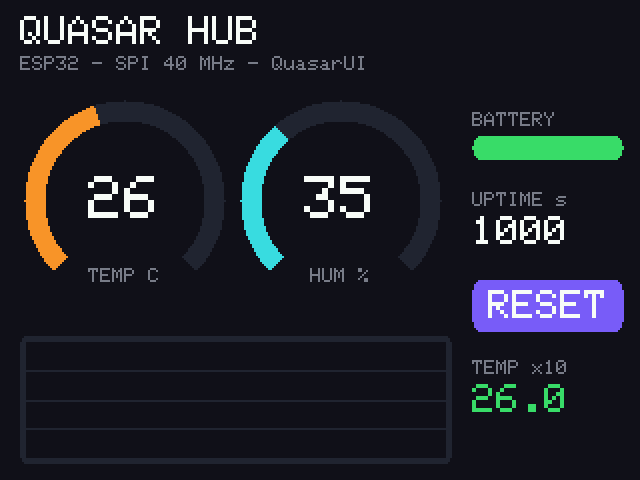

<div align="center">

# ⚡ QuasarUI

**Draw once. Send only what changed.**
A tiny, dependency-free UI toolkit for SPI TFTs — framebuffer, dirty-rectangle flushing, gauges, graphs and widgets in a few hundred lines of portable C++.




<sub>Rendered by the bundled host simulator running the <b>real library code</b> against a virtual ILI9341 (2× upscaled). See <a href="#honest-status">Honest status</a> — hardware photos are welcome via PR.</sub>

</div>

---

## Why you'd want this

Pushing a full 320×240 frame over 40 MHz SPI takes **~31 ms**. Most dashboards change a gauge, a label and a chart per tick — not the whole screen.

QuasarUI keeps a RGB565 framebuffer in RAM, tracks what each widget touched, and sends **only those rectangles**:

| Scenario (320×240, 40 MHz SPI, simulated) | Pixels sent | SPI time |
|---|---:|---:|
| Full redraw | 76 800 | 30.7 ms |
| Demo dashboard, *every* widget changing every frame | ~29 000 (38 %) | ~11.6 ms |
| Idle frame (nothing changed) | **0** | **0 ms** |
| One label update | ≤ label rect | ≪ 1 ms |

Numbers come from `test/render_gallery.cpp` (it prints them); real throughput depends on your MCU and SPI driver.

## Features

- **Transport abstraction** (`qs::Bus`) — the core never touches Arduino or IDF headers; swap in any SPI layer.
- **Panels:** ST7789 (240×240, 240×320) and ILI9341 (240×320), 4 rotations, 240×240 RAM-offset handling.
- **Canvas:** clipped primitives (rect, line, circle, round-rect, arc), scalable built-in 5×7 font, dirty-rect tracking.
- **Widgets:** `Label`, `ProgressBar`, `Gauge` (270° dial), `Graph` (ring buffer, auto/fixed range, no heap), `Button`.
- **`Screen`:** redraws only invalid widgets, one flush per widget so distant updates never merge into a giant rectangle.
- **No heap use inside the library**; you own the framebuffer and graph storage.
- **Host simulator + unit tests** — a virtual panel decodes `CASET/RASET/RAMWR`, so tests assert what reaches the glass.

## Quick start (Arduino-ESP32)

```cpp
#include <QuasarUI.h>
using namespace qs;

ArduinoSpiBus bus(SPI, /*cs*/5, /*dc*/2, /*rst*/4, 40000000UL);
Panel  panel(bus, PanelConfig::ILI9341_240x320());
Label  title({10, 8, 220, 16}, 2);
Gauge  temp(62, 100, 50, "TEMP C", colors::Orange);
Canvas* canvas; Screen* screen;

void setup() {
    canvas = new Canvas((Color*)malloc(Canvas::bytesFor(320, 240)), 320, 240);
    panel.begin();  panel.setRotation(1);
    screen = new Screen(*canvas, panel);
    screen->add(&title); screen->add(&temp);
    title.setText("QUASAR HUB");  temp.setRange(0, 60);
}
void loop() {
    temp.setValue(readTemperature());
    screen->update();          // sends nothing if nothing changed
    delay(100);
}
```

Full sketch: [`examples/Dashboard`](examples/Dashboard/Dashboard.ino). Install by copying the folder into your Arduino `libraries/`, or via PlatformIO (`library.json`).

**Wiring (ESP32 VSPI):** SCK 18 · MOSI 23 · CS 5 · DC 2 · RST 4 · LED → 3V3.

## Memory

| Display | Framebuffer |
|---|---:|
| 240×240 | 112.5 KB |
| 320×240 | 150 KB |

Allocate with `malloc` (not a static array) on ESP32 — static DRAM is limited. AVR boards (Uno/Nano) have far too little RAM for a full framebuffer; they are **not supported** by this version.

## Port to another platform

Implement five methods of `qs::Bus` (`begin`, `reset`, `command`, `data`, `delayMs`). `ArduinoSpiBus` is ~50 lines; use it as a template for ESP-IDF `spi_master`, Pico SDK or Linux spidev.

## Build & test on your PC

```bash
cmake -S . -B build && cmake --build build && ctest --test-dir build --output-on-failure
./build/render_gallery ./out     # writes PPM frames + stats.csv
```

or without CMake:

```bash
g++ -std=c++11 -O2 test/test_main.cpp src/qs_panel.cpp src/qs_canvas.cpp src/qs_font5x7.cpp src/qs_widgets.cpp -o tests && ./tests
```

## Honest status

| Area | State |
|---|---|
| Core, widgets, dirty-rect flush | ✅ unit-tested on host (38 checks, GCC 6.3 `-Wall -Wextra`) |
| ST7789 / ILI9341 init sequences | ⚠️ standard vendor sequences, **not yet verified on physical panels** |
| `ArduinoSpiBus` | ⚠️ **not yet compiled/tested on a board** |
| ESP-IDF `Bus` implementation | ❌ not included yet (CMake component builds the core) |
| Images in this README | Simulator renders, **not** photos of hardware |

Tried it on real hardware? Open an issue or PR with your board, panel and a photo — that's the fastest way to move a ⚠️ to ✅.

## Roadmap

ESP-IDF SPI bus with DMA · async flush · RGB565 sprites/bitmaps · more fonts · ST7735 / GC9A01 · touch input helpers.

## License

MIT © 2026 Quasar Soft
